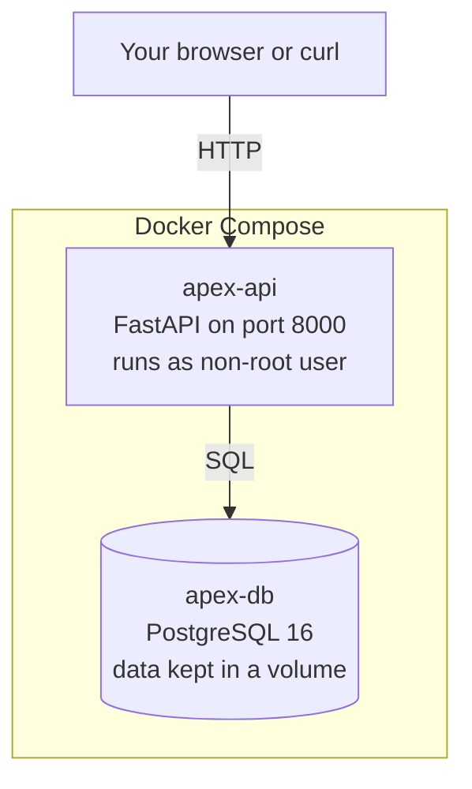

# Architecture

## What this is

A small API that tracks operations work. It runs in two containers on your
machine: the API itself and a PostgreSQL database.

That is the whole system. Nothing here is complicated on purpose — the goal is
to show a reliable path from a code change to a running release, not to build
something big.



## The two containers

| Container | Image | What it does | How it is checked |
|---|---|---|---|
| `apex-api` | Built from our `Dockerfile` | Serves the API | `HEALTHCHECK` calls `/healthz` |
| `apex-db` | `postgres:16-alpine` | Stores the data | `pg_isready` in its healthcheck |

The API container waits for the database to be healthy before it starts
(`depends_on: condition: service_healthy`). This avoids the API booting up and
crashing because the database was not ready yet.

The database data lives in a named volume called `db_data`, so it survives
`docker compose down` and restarting the container.

## The application

Everything is in one file, `app/main.py`. For a service this size that is easier
to review than splitting it across folders.

| Part of `main.py` | What it does |
|---|---|
| Settings at the top | Reads configuration from environment variables |
| Logging setup | Prints one JSON object per line so logs are easy to search |
| `Operation` class | The database table |
| `create_engine` / `get_db` | Connects to the database, gives each request a session |
| `check_database()` | Simple "can we reach the database?" check |
| Route handlers | The endpoints |
| Middleware | Adds a request ID to every request and logs it |

## Endpoints

| Method | Path | Purpose |
|---|---|---|
| GET | `/healthz` | Is the app running? |
| GET | `/readyz` | Is the app running **and** can it reach the database? |
| GET | `/api/v1/operations` | List operations |
| POST | `/api/v1/operations` | Create an operation |
| GET | `/api/v1/operations/{id}` | Get one operation |

## Why there are two health endpoints

This is the most important design decision in the project.

- `/healthz` only checks that the process is alive.
- `/readyz` also checks that the database is reachable.

If `/healthz` also checked the database, then a database outage would make
Docker think the API container is broken and restart it. You would get a restart
loop while the real problem (the database) was still there.

Keeping them separate means:
- The database goes down → `/healthz` stays green, `/readyz` turns red.
- The API stays up and recovers by itself once the database comes back.

## Request flow

Every request gets an ID so you can follow it through the logs.

```
curl -H 'X-Request-ID: my-request-1' http://localhost:8000/api/v1/operations
```

The log line for that request will contain `"request_id": "my-request-1"`.

```json
{"method": "GET", "path": "/api/v1/operations", "status": 200, "duration_ms": 4.2, "event": "request.completed", "request_id": "my-request-1", "level": "info", "timestamp": "2026-10-29T18:33:11.063816Z"}
```

## Versions and rollback

Each release gets its own image tag:

```
apex-ops-api:0.1.0
apex-ops-api:0.2.0
```

The scripts remember what is running:

| File | What it holds |
|---|---|
| `.deploy/current-release` | The image tag running right now |
| `.deploy/previous-release` | The one before it — the rollback target |

`deploy.sh` moves the old tag into `previous-release` before starting the new
one, so `rollback.sh` always knows exactly where to go back to.

## Where this would go next

For a real deployment the same containers would run on a managed container
service with a managed PostgreSQL database. The details are in
`docs/decision-memo.md`.
